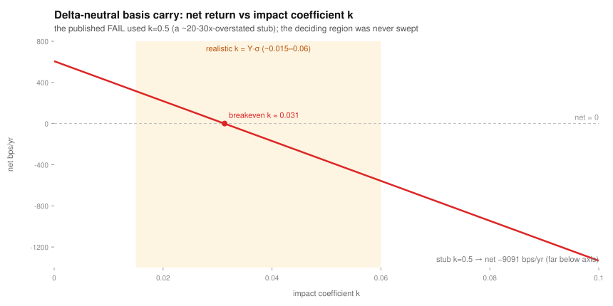

# Crypto Strategy Research & Validation Framework

An overfitting-resistant research pipeline for testing whether a retail-scale operator can beat
**BTC buy-and-hold net of realistic costs** — built on a single VPS, and designed above all *not to fool
the researcher*. The deliverable is the **method**: how to tell a real edge from an overfit backtest,
and how to report an honest result — including correcting one's own conclusion when the method says to.

[](https://github.com/vavaxa/crypto-strategy-validation/actions/workflows/tests.yml)

**Flagship artifact — applied risk analysis:** [`reports/hyperliquid_hlp_risk.md`](reports/hyperliquid_hlp_risk.md)
draws a risk conclusion about a *live* system — Hyperliquid's HLP liquidation backstop — from its own
public API: a **~$37M mechanical loss cap** (then ADL), **procyclical capital** (−$489M of withdrawals, not
losses), and **79% of headline capital not locatable** in public accounts. For DeFi-risk work this is the
core of the portfolio; the strategy studies below are the methodology spine.

> **What is established:** a reusable, numerically-verified validation stack (DSR/PSR, PBO/CSCV,
> White/Hansen SPA, Lo-HAC Sharpe, purged k-fold) applied to seven strategy studies with per-study
> anti-lookahead audits. No study demonstrated an edge that clearly beats BTC buy-and-hold.
>
> **What is NOT established (and is labelled as such):** the cost-sensitive studies (trend, funding
> carry, basis carry) were scored with an **uncalibrated market-impact stub that overstates impact ~20–30×**.
> Their correct label is **INCONCLUSIVE (impact-calibration-dependent)**, not "fail." See the
> [Correction](#correction-2026-10) note below — surfacing and labelling this is the point of the method.

---

## Correction (2026-10)

A review pass against the square-root law found that `costs.py` used a constant square-root-impact
coefficient `impact_k = 0.5`, whereas the square-root law implies a **per-symbol** `k ≈ Y·σ_daily`
(Y≈0.5–1): ~0.015–0.03 for BTC, ~0.05–0.08 for high-vol alts. The stub overstates realistic impact by
roughly 20–30× (e.g. $1M in BTC ≈ single-digit bps, not ~70 bp).

This **changes the verdict** for the cost-sensitive studies. For delta-neutral basis carry the report's
own diagnostics show net return crosses zero at **impact_k ≈ 0.031**, while the sensitivity grid only
spanned 0.125–2 — i.e. the deciding region was never tested, and a physically-impossible −99.8% maxDD
on a delta-neutral book was a cost-model artifact, not a market outcome. At a calibrated `k≈0.02` basis
carry is **marginally positive gross of the remaining (non-impact) risks**, so the honest label is
INCONCLUSIVE pending (a) per-symbol `k = Y·σ` (see `impact_k_from_vol()` in `costs.py`) and (b) a data
re-collection + re-run. The validation **core** was independently verified correct and is unaffected.

**Aggregate verdict at a calibrated k.** Impact is linear in k, so basis-carry net is
`net(k) = 606 − 19394·k` bps/yr (from the report's own numbers): zero at `k≈0.031`, and **+218 bps/yr at a
BTC-like `k≈0.02`**. So once costs are calibrated the aggregate sign is *marginally positive*; the pending
re-run is needed only to get the **per-symbol** `k` weighting right (it reweights across symbols), not to
settle the aggregate sign. This is a correction that changed the conclusion — not a bug found and parked.



---

## Methodology (the verified core)

**1. Pre-registration discipline.** Each study's hypothesis, parameter grid (= multiple-testing budget),
decision rule, and an explicit "what NOT to do" clause are frozen in a `PREREG_*.md`. *Caveat:* this
repo is a single publication commit, so the pre-registration ordering is **documented, not
cryptographically proven**; a timestamped, commit-separated history would be needed to prove it to a
third party.

**2. Anti-lookahead design.** Signals on `close(t)`, lagged with `shift(1)`, executed at the next bar's
**open**; as-of joins across series; a per-study lookahead self-audit (including an empirical holdout-
isolation check, max|W_full − W_IS| = 0).

**3. Survivorship-free, point-in-time data.** The daily universe (689 symbols) is reconstructed from
trailing turnover and *includes delisted symbols*. *Caveat:* the 77-symbol hourly/funding subset was
selected by turnover at a fixed date (2026-10-19), which is not strictly point-in-time for that layer —
documented in `data/DATA_MANIFEST.md`.

**4. Realistic execution costs.** Fees + square-root market impact + participation cap. The impact
*sensitivity sweep* was run, but around an overstated stub (see Correction); the lesson kept here is that
a sweep is only as honest as the range it spans and the calibration it starts from.

**5. A formal, numerically-verified validation stack** (`research/validation/`):
- Deflated & Probabilistic Sharpe Ratio (DSR/PSR) — PSR matches the Bailey–López de Prado formula to ~1e-16
- Probability of Backtest Overfitting (PBO) via CSCV — ≈0.5 on pure noise, →0 on a dominant strategy
- White's Reality Check & Hansen's SPA — SPA more powerful than RC, as expected
- Lo-adjusted Sharpe with Newey–West HAC SE — matches Lo (2002) analytics to ~0.2%
- Stationary / block bootstrap CIs; purged k-fold CV with embargo; Jobson–Korkie–Memmel Sharpe-diff test

---

## Studies

Seven studies have full artifacts in this repo (#2–#8). Study #1 is summarised from an earlier,
separate on-chain track whose code/report are **not** in this repo (shown for context only).

| # | Hypothesis | Premium real? | Verdict | Note |
|---|------------|---------------|---------|------|
| 1 | On-chain inflow → pump *(external track; no artifacts here)* | no | ✗ | marker causal, gross move ≈ 0 |
| 2 | Trend / breakout, 30-alt basket | no | **INCONCLUSIVE** | impact-calibration-dependent (see Correction) |
| 3 | Funding carry (long-biased) | **yes** (+564 bps/yr, t≈4.8) | **INCONCLUSIVE** / doesn't beat BTC | small; net sign depends on impact calibration |
| 4 | Carry as overlay to BTC | — | ✗ | corr 0.66 with BTC = beta, not hedge; dilution |
| 5 | Delta-neutral basis carry | **yes & uncorrelated (~0)** | **INCONCLUSIVE** | breakeven impact_k ≈0.031; marginal at calibrated k |
| 6 | Single-asset BTC timing | point-wise (SR 1.29 vs 0.93) | ✗ | not significant (CI includes 0) = dilution |
| 7 | Short-vol / VRP (DVOL) | **yes** (+8.4 vol-pts, t≈5.4) | ✗ | ruinous tail, fails holdout, decaying |
| 8 | Market-making (mark-out) | spread < maker fee | ✗ | even front-of-queue; tail p5 −6…−8 bp > edge |

Studies 4, 6, 7, 8 do **not** fail on impact calibration (dilution / insignificance / tail / maker-fee
floor), so their verdicts stand; studies 2, 3, 5 are the impact-sensitive ones now labelled INCONCLUSIVE.

---

## Key findings

- **The sample-length wall stands.** Crypto has ~1.5–2 full cycles, so slow regime effects (study 6) and
  tail non-ruin (study 7) cannot be confirmed statistically even if a modest real effect exists.
- **The cost×turnover wall is real in principle but was not honestly quantified here.** Our impact stub
  was ~20–30× too high (see Correction), so "costs kill it" is demonstrated *only* for maker-fee-floored
  market-making (study 8) and for genuine dilution/insignificance (studies 4, 6) — **not** for the
  turnover strategies (2, 3, 5), which are INCONCLUSIVE pending calibrated costs.
- **Three statistically-real premia, none shown to net-harvest at retail scale:** funding carry,
  delta-neutral basis, and the volatility risk premium. Each is small, or payment for crash risk
  (short-vol is +0.81 correlated with BTC on crash days), and appears to decay over time.
- **The honest baseline.** Holding BTC sized to risk tolerance was not beaten on a risk-adjusted basis by
  any study here — subject to the cost caveat above. An optional ~100/200-day regime filter roughly
  halved historical drawdown but is **not** statistically validated (a comfort tool, not alpha).

---

## Known limitations / open items

- **Impact calibration + re-run** of studies 2/3/5 with `k = Y·σ` (grid 0.005–0.10) — pending data
  re-collection; expected to move basis carry to "marginally positive / live-paper-pending."
- **Pre-registration provability** — split PREREG files into timestamped pre-run commits (e.g. with
  OpenTimestamps) to prove ordering externally.
- **Bootstrap size** — raise `n_boot` to 5000 for verdict-bearing RC/SPA runs and add a size-under-null test.
- **Borrow-rate stub** (`borrow_rate_annual=0`) is a second sign-sensitive assumption for the basis short leg.
- **Language** — PREREG files and `DATA_MANIFEST.md` are in Russian (working language); summaries in English.

---

## Repository structure

```
research/validation/   DSR/PSR, PBO/CSCV, White/Hansen SPA, Lo-HAC Sharpe, bootstrap, purged CV (+ tests)
research/execution/     costs.py (fee + sqrt-impact + participation cap; impact_k_from_vol helper) (+ tests)
research/strategy/       signal construction + anti-lookahead test
research/*_runner.py     studies 2–8 (mech=trend, carry, overlay, basis, btc_timing, vrp, mm_markout)
research/hl_*.py         Hyperliquid HLP risk study (collector, analysis, calcs, figures)
research/PREREG_*.md     frozen pre-registrations
reports/                 RESEARCH_CONCLUSION.md + per-study .md/.json + hyperliquid_hlp_risk.md + charts
data/DATA_MANIFEST.md    sources, windows, symbols (data reconstructible; git-ignored)
```

## Reproducing

```bash
pip install -r requirements.txt
python -m pytest research/validation research/execution research/strategy   # test suite, no downloads
python research/mech_collect.py                 # rebuild the data layer from public APIs
python research/carry_runner.py                 # then re-run any study
```

*Reproducible: the aggregate statistics (cumulative PnL, Sharpe, p-values, decomposition). Not fixed: the
`allTime`-window bucket edges in the Hyperliquid study, which the API re-buckets on each snapshot.*

## Not financial advice

A research and methodology demonstration. Nothing here is investment advice. The point is the method —
including labelling a conclusion INCONCLUSIVE when an uncalibrated parameter, not the data, was driving it.
