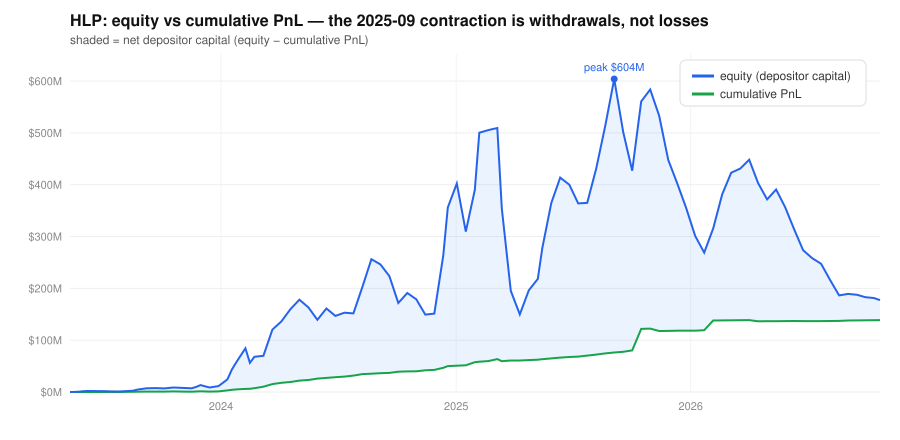

# Hyperliquid HLP: the liquidation backstop is ~$37M (ADL caps it), and its capital chases yield

*Independent risk note on the **liquidation channel** of HLP (~21% of its NAV). Snapshot: 2026-10-23,
from the keyless Hyperliquid `info` API (`vaultDetails` + `clearinghouseState` + `spotClearinghouseState`).
Reproducible — [`research/hl_collect.py`](../research/hl_collect.py),
[`research/hl_analysis.py`](../research/hl_analysis.py),
[`research/hl_risk_calcs.py`](../research/hl_risk_calcs.py),
[`research/hl_figures.py`](../research/hl_figures.py).*

## Scope

HLP is a **protocol vault with four jobs**: per the docs it "provides liquidity to Hyperliquid through
multiple market making strategies, performs liquidations, supplies USDC in Earn, and accrues a portion of
trading fees" [[1]](#sources). This note is about the **liquidations** job — the backstop — which is where
auto-deleveraging and tail risk live. That channel is only **~21% of HLP's $177.4M NAV**; the remaining
~$140M sits in Earn (USDC lending) and market-making, and carries ordinary **credit and market-making
risk that ADL does not bound**. A full HLP risk picture would have to cover those too.

## Summary

1. **Losses through the liquidation backstop are mechanically capped at the perp account's equity
   (~$37.3M), then ADL takes over.** ADL triggers when an account's value goes negative and closes
   opposite positions at the previous mark price, "ensuring that the platform has no bad debt"
   [[2]](#sources). The HLP perp account — live `clearinghouseState.accountValue` **$37.3M, zero open
   positions, ~fully withdrawable** — is a *hard ceiling* on backstop losses, not a fraction of OI.
2. **That capital is procyclical — but toward yield, not away from stress.** The largest single inflow
   (+$92.2M) landed in the **crash/deleveraging fortnight of Oct-2025 — the same interval as the +$41.4M
   trading windfall.** Depositors chase visible yield *into* stress and bleed *out* in calm markets as the
   yield fades (after the Sep-2025 peak: +$296M in across 9 intervals vs −$785M out across 21 — not a
   monotonic drain). The one true run was JELLY (Mar-2025). And a **4-day deposit lock-up** means no
   depositor can exit inside an event.
3. **The thin margin cushion is BTC/ETH at max leverage (~0.83% / ~1.33% of notional)** — the deepest
   books — not the low-OI alts a share-of-OI lens would flag.

## Background: book → liquidator vault → ADL

Per the docs [[3]](#sources)[[2]](#sources):

- **Tier 1 — the book.** "The positions are first attempted to be entirely closed by sending market
  orders to the book."
- **Tier 2 — the liquidator vault.** "Positions that are below 2/3 of the maintenance margin can be taken
  over by the liquidator vault, which is a component strategy of HLP." Maintenance margin "is half of the
  initial margin at max leverage, which varies from 3-40x."
- **Tier 3 — ADL.** "If a user's account value … becomes negative," opposite-side traders "are ranked by
  unrealized pnl and leverage used" and "their positions are closed at the previous mark price against the
  now underwater user, ensuring that the platform has no bad debt."

HLP depositors are the *second* line, and their backstop loss is **capped** at the liquidator-vault/perp
capital; past that, ADL — not the fund — absorbs the residual by closing solvent traders' opposite
positions at the previous mark (the cost comes out of those traders' unrealised gains; ADL caps the
vault's loss, it does not reimburse it).

## Data and method

One snapshot of the public `info` endpoint plus live `clearinghouseState` / `spotClearinghouseState`
cross-checks. **Account-level queries see only the master address**: the docs warn "to query the account
data associated with a master or sub-account, you must pass in the actual address of that account"
[[4]](#sources). So the ~$140M in HLP's Earn/market-making strategies is not visible at the vault address —
by design, not by omission.

**Granularity caveat:** `vaultDetails` resolves full history only at ~14-day steps (sub-daily only for the
last ~31 days). Reproducible figures are the aggregates; `allTime` bucket *edges* re-bucket each snapshot,
so interval dates are indicative and all extremes below are **sampled/observed**, not true extrema.

## Finding 1 — the backstop is a ~$37M account with a mechanical cap; the rest is other strategies

The liquidation channel's capital is the **perp account**: live `clearinghouseState` reports
**accountValue ≈ $37.3M, zero open positions, essentially all withdrawable**; the snapshot's `perpAllTime`
slot agrees (~$37.3M; `clearinghouseState.accountValue == perpAllTime` to well under $1). Because ADL
guarantees "no bad debt" by socialising beyond that
point, **~$37.3M is a mechanical ceiling on backstop loss** (the liquidator vault being "a component
strategy" of that perp slot, so its own capital is **at most** ~$37.3M).

The other ~$140M of the $177.4M NAV is **not missing** — it is HLP's Earn and market-making strategies,
which live in separate sub-accounts the public API only exposes by their own addresses [[4]](#sources).
The legitimate transparency gap is narrower: **the protocol does not publish per-strategy NAV**, so a
depositor cannot see how much capital backs each of the four jobs, or how Earn's credit exposure is sized.

*What would falsify this:* Hyperliquid publishing per-strategy NAV that shows the liquidator vault is
capitalised above the perp account. The whole cap argument also **depends on the perp account being a
separate account with no regress to the Earn/MM capital** — which the account structure implies but the
docs do not guarantee (noted in Limitations).

## Finding 2 — capital chases yield into stress, and is locked for 4 days



Decomposing `equity = net deposits + cumulative PnL`, from the sampled peak 2025-09-03 ($603.9M) to now
($177.4M): **dEquity −$426.5M = PnL +$62.6M + net flows −$489.1M.** The contraction is withdrawals, not
losses. But the flows are **not** a monotonic flight:

- After the peak, **+$296M flowed in across 9 intervals** against −$785M out across 21.
- The **largest inflow (+$92.2M) was the Oct-2025 crash/deleveraging fortnight** — the *same* interval as
  the +$41.4M trading windfall. Depositors piled in *because* HLP visibly printed money in the crash.
- The one genuine run was **JELLY (Mar-2025): −$160.3M of outflow** in the interval around the delisting,
  while that interval's PnL was +$1.24M.

So HLP capital is procyclical **toward realised yield**: it swells right after a visible stress-windfall
and bleeds out in calm markets as the yield normalises (APR is now 3.65%). The buffer is therefore
*thinnest in quiet markets* — precisely when the next event is not yet priced. And a **4-day deposit
lock-up** ("you can withdraw 4 days after your most recent deposit" [[1]](#sources)) means a depositor
**cannot exit inside an event** — which is why the Mar-2025 run played out over two weeks, not hours.

*What would falsify this:* intra-fortnight flow data showing the Oct-2025 deposits *preceded* the windfall
(the ~14-day bucket cannot separate the two); or sticky capital that does not fade in calm markets.

## Finding 3 — the thin cushion is BTC/ETH at max leverage

Maintenance margin is **half the initial margin at max leverage** [[3]](#sources), so the cushion before
the liquidator vault is underwater on an inherited position ≈ (2/3)·MM of notional:

| Max leverage | Maintenance margin | Cushion ≈ (2/3)·MM | Example |
|---|---|---|---|
| 40x | 1.25% | **0.83%** | BTC |
| 25x | 2.00% | **1.33%** | ETH |
| 20x | 2.50% | 1.67% | SOL |
| 10x | 5.00% | 3.33% | HYPE |
| 5x | 10.0% | 6.67% | ATOM |
| 3x | 16.7% | 11.1% | long tail |

The thinnest cushions are on the **deepest books (BTC, ETH)** at max leverage — a gap through <1.3% of
notional hands the vault an underwater position — not the low-OI alts.

The worst realized backstop event was idiosyncratic, not beta. JELLY (Mar-2025) was a manipulated,
thinly-listed market with "$230 million stored within the HLP at risk of potential liquidation"; Halborn
reports that "when losses reached **$12 million**, the protocol's validators rapidly … delist[ed] the
$JELLY token," settling at $0.0095 vs the $0.50 listing — which "revealed that Hyperliquid was far less
decentralized than it claimed" [[5]](#sources).

> ~14-day interval nets are **not** event losses. The largest known event loss (~$12M on JELLY) exceeds
> the worst *observed* interval (−$4.66M, a statistically unremarkable z = −1.31), which is exactly why the
> realized curve cannot be read as a measure of the tail.

*What would falsify this:* trade-level data showing inherited BTC/ETH inventory is consistently unwound
inside the <1.3% max-leverage cushion (so the deepest books never actually stress the vault). The public
~14-day data can neither confirm nor refute it — which is itself the limit.

## A labelled scenario (not a prediction): HYPE reflexivity

HYPE — the ecosystem's own token — is 13.8% of OI ($1.6B) at 10x. No long/short split in the API; funding
is positive (longs pay), so longs likely dominate, but this is **not sized**, so `f` is an assumption.
Using the Finding-3 cushion, an inherited position only costs the vault beyond its margin, so loss
`= f · $1.6B · max(0, c − 3.33%)`, against the ~$37.3M perp cap (the 3.33% assumes *all* inherited HYPE is
at max leverage — a conservative upper bound; lower average leverage means a larger cushion and smaller
loss):

| f \ c | 5% | 10% | 20% | 30% |
|---|---|---|---|---|
| 5% | 4% | 14% | 36% | 57% |
| 10% | 7% | 29% | 71% | 114% |
| 20% | 14% | 57% | **143%** | 228% |

(loss as % of the ~$37.3M perp cap). At f = 20%, c = 20% the loss is ~$54M — the liquidator vault is
exhausted and the remainder routes to ADL. A sensitivity point from the protocol's own cushion mechanics,
not a forecast.

## Other sign-sensitive channels

- **USDC depeg.** HLP's NAV is USDC-quoted and the Earn leg is a USDC claim, so a depeg (cf. Mar-2023)
  hits that directly with no market move required (the market-making inventory is held in tokens).
- **Validator concentration.** JELLY was resolved by **delisting** — a 2/3 stake-weighted validator vote
  that "revealed that Hyperliquid was far less decentralized than it claimed" [[5]](#sources). The third
  backstop tier rests on a small operator set; depositors should price validator discretion, not an
  automatic rule.

## Recommendations

**For an HLP depositor.** The ~3.65% APR is not tail compensation — it is mechanically a shrinking-base
artifact (same PnL over less capital as it drains in calm markets). Backstop loss is capped at the ~$37M
perp account, but your deposit also sits in Earn/MM strategies with unbounded (non-ADL) credit/MM risk,
you **cannot withdraw for 4 days**, and per-strategy NAV is not published.

**For a risk mandate.** Flows are already public (`userNonFundingLedgerUpdates`). Ask for (a) per-strategy
NAV (how much backs liquidations vs Earn vs MM), and (b) intra-event HLP PnL and inherited inventory by
market — the only data that would let anyone evidence tail safety. Cap single-market backstop
concentration (HYPE first, for reflexivity).

**For validators.** Make the trigger and process for discretionary intervention (as in the JELLY delist)
explicit; an implicit, stake-weighted backstop-of-last-resort should not be priced as automatic.

## Limitations

- Covers the **liquidation channel only (~21% of NAV)**; Earn/MM credit and market-making risk are out of
  scope here.
- The ~$37M loss cap **depends on the perp account being isolated with no regress** to the Earn/MM capital
  — implied by the account structure, not guaranteed by the docs.
- One public snapshot; ~14-day history resolution hides intra-event dynamics; extremes are sampled.
- JELLY magnitude is Halborn's single figure; the HYPE scenario's `f`, `c` are assumptions (3.33% cushion
  assumes max leverage).
- Independent analysis, not an audit, not affiliated with Hyperliquid.

## Sources

1. Hyperliquid docs — Protocol vaults / HLP: https://hyperliquid.gitbook.io/hyperliquid-docs/hypercore/vaults/protocol-vaults
   (HLP "provides liquidity … through multiple market making strategies, performs liquidations, supplies
   USDC in Earn, and accrues a portion of trading fees"; "The deposit lock-up period is 4 days").
2. Hyperliquid docs — Auto-deleveraging: https://hyperliquid.gitbook.io/hyperliquid-docs/trading/auto-deleveraging
   ("account value … becomes negative"; "closed at the previous mark price against the now underwater
   user, ensuring that the platform has no bad debt").
3. Hyperliquid docs — Liquidations: https://hyperliquid.gitbook.io/hyperliquid-docs/trading/liquidations
   ("market orders to the book"; "below 2/3 of the maintenance margin … liquidator vault, which is a
   component strategy of HLP"; "maintenance margin is half of the initial margin at max leverage").
4. Hyperliquid docs — Info endpoint: https://hyperliquid.gitbook.io/hyperliquid-docs/for-developers/api/info-endpoint
   ("to query the account data associated with a master or sub-account, you must pass in the actual
   address of that account").
5. Halborn — "Explained: The Hyperliquid JELLY incident (March 2025)":
   https://www.halborn.com/blog/post/explained-the-hyperliquid-hack-march-2025 ("$230 million stored
   within the HLP at risk"; "when losses reached $12 million … delist the $JELLY token"; settled at
   $0.0095 vs $0.50; "far less decentralized than it claimed").
6. HLP vault `0xdfc24b077bc1425ad1dea75bcb6f8158e10df303` via the public `info` API — primary data.

## Reproducibility

```bash
python research/hl_collect.py        # snapshot the public API into data/hl/ (git-ignored)
python research/hl_analysis.py       # factual summary
python research/hl_risk_calcs.py     # the findings' numbers
python research/hl_figures.py        # the equity / PnL / net-deposits chart (SVG)
```

*Not financial advice. Independent research for discussion.*
